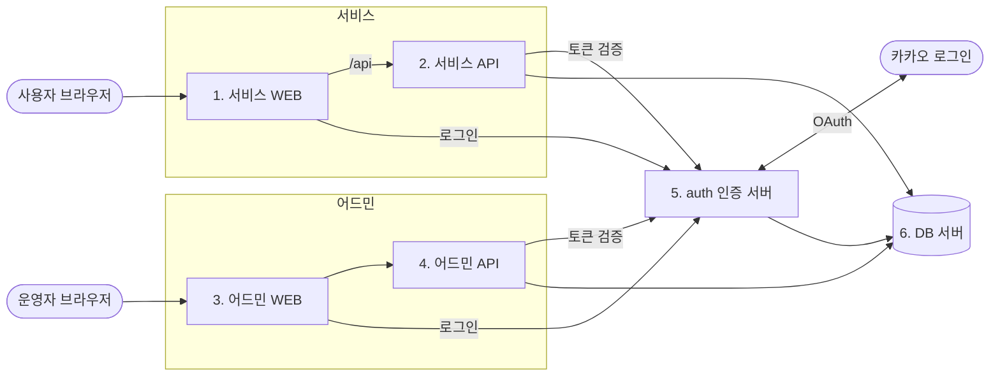

# g-log

g-log는 화분에 꽂은 센서가 한 시간마다 토양 수분을 기록하고, 건조·과습·센서 연결 끊김처럼 사용자가 확인해야 하는 상황을 알려 주는 실내 식물 수분 관리 서비스다. 이 저장소에는 g-log 백엔드의 API 명세(`openapi.yaml`)와, 그 명세를 Swagger UI로 보여 주는 페이지가 들어 있다.

- API 문서: https://pajama-parties.github.io/g-log_info/

## 주요 기능

- 대시보드: 화분별 현재 수분, 상태(적정·건조·과습·오프라인. 오프라인은 센서 측정값이 2시간 넘게 오지 않은 상태), 최근 24시간과 7일 동안의 수분 변화
- 화분 관리: 화분 추가와 센서 연결, 화분별 적정 범위(건조 기준·과습 기준) 설정
- 알림함: 건조·과습·센서 연결 끊김·새 조언 알림과, 지난 7일 동안 화분별로 발생한 건조·과습·오프라인 경보 횟수 요약
- 조언 기록: 수분 변화와 작물·흙 종류를 근거로 만든 관리 조언과 사용자 평가
- 커뮤니티: 질문·기록 공유·팁 글, 공감과 댓글, 화분 그래프 첨부
- 계정: 카카오 또는 이메일 로그인, 닉네임 변경, 서비스 탈퇴

## 서버 구성도

g-log는 사용자용 서비스와 운영자용 어드민을 서로 다른 웹과 API로 분리하고, 인증 서버와 DB 서버를 두 API가 함께 사용하는 구조다.

| 번호 | 서버 | 역할 |
|---|---|---|
| 1 | 서비스 WEB | 사용자가 보는 웹 화면(대시보드, 화분, 알림함, 조언 기록, 커뮤니티, 계정) |
| 2 | 서비스 API | 서비스 WEB이 호출하는 API. 이 저장소의 `openapi.yaml`이 명세함 |
| 3 | 어드민 WEB | 운영자가 사용자, 화분, 센서, 커뮤니티 글을 관리하는 웹 화면 |
| 4 | 어드민 API | 어드민 WEB이 호출하는 운영용 API |
| 5 | auth 인증 서버 | 카카오·이메일 로그인과 세션·토큰 발급, 다른 서버의 토큰 검증 요청 처리 |
| 6 | DB 서버 | 사용자, 화분, 측정값, 알림, 조언, 커뮤니티 데이터 저장 |

## 저장소 구성

| 파일 | 내용 |
|---|---|
| `openapi.yaml` | 서비스 API의 OpenAPI 3.0 명세 |
| `index.html` | `openapi.yaml`을 불러와 보여 주는 Swagger UI 페이지 |
| `.github/workflows/pages.yml` | 명세를 검사하고 GitHub Pages에 배포하는 워크플로 |

## API 문서 갱신 방법

`openapi.yaml`을 수정해서 `main` 브랜치에 push하면 GitHub Actions가 아래 순서로 문서를 갱신한다. 수정한 명세가 검사를 통과하지 못하면 배포하지 않으므로, 기존 문서가 그대로 유지된다.

1. Redocly CLI로 `openapi.yaml`의 문법과 참조를 검사한다.
2. `index.html`과 `openapi.yaml`을 GitHub Pages에 배포한다.

명세의 각 API 동작에는 `x-status` 값이 적혀 있다. `x-status: 화면 연동됨`은 서비스 WEB이 이미 호출하는 API를, `x-status: 제안`은 서비스 WEB이 아직 화면 안에서만 처리하는 동작을 서비스 API로 옮길 때 쓰도록 제안한 API를 뜻한다.
